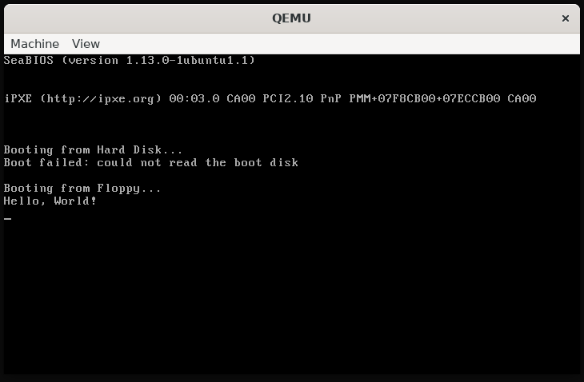

# OS

## Prerequisites
```shell
$ apt install make nasm qemu
```

## Installing
```shell
$ git clone https://github.com/revandrazm/OS.git
$ cd OS
$ make && qemu-system-i386 -fda build/main_floppy.img
```

### Expected Output

